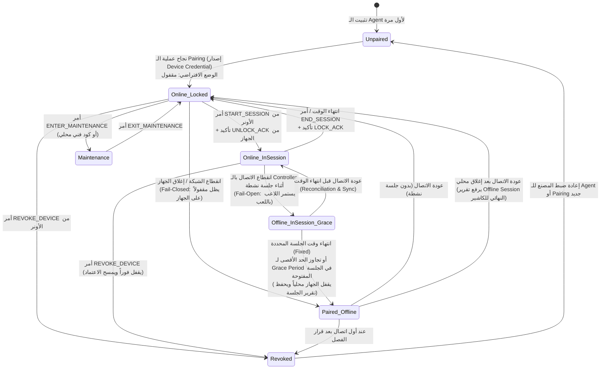

# CCMS Device Control & Enforcement Engine
## Deep Technical Analysis & Architecture Proposal

**الدور:** Senior Software Architect (Windows System Programming & Real-Time LAN Systems)  
**النسخة المرجعية للمشروع:** CCMS v1.4.6 (`/package.json`)  
**نطاق الوثيقة:** تحليل معماري وتصميم هندسي شامل لتحويل CCMS من نظام تسجيل محاسبي (Passive Logging) إلى نظام تحكم وإنفاذ فعلي على الأجهزة (Active Enforcement & Control Plane) بدون تعديل أي ملف كود داخل الـ Repository.

---

## 1. ملخص بنية المشروع الحالية والتحقق المرجعي (Current System Audit)

بعد الفحص المباشر لملفات المستودع (Repository)، نؤكد الحقائق المعمارية التالية مع مراجعها الدقيقة:

### 1.1 التحقق من الفرضيات الأساسية
* **Multi-Tenant & Offline-First:**
  * النظام يعزل بيانات كل فرع/مشترك بواسطة `tenant_id` في جميع الجداول الأساسية (`/server/src/lib/database.ts:L48-L426`، وملف الهجرة `/server/migrations/015_rls_tenant_isolation.sql`).
  * يعمل محلياً بالكامل بدون إنترنت عبر محرك SQLite المترجم إلى WebAssembly (`sql.js` في `/server/package.json:L28`)، ويحفظ قاعدة البيانات محلياً في `%APPDATA%/ccms/ccms.db` كل 5 ثوانٍ وعند كل عملية كتابة (`/server/src/lib/database.ts:L29-L44`, `/server/src/index.ts:L154`).
  * يحتوي `/server/src/lib/local-db.ts` على كلاس `LocalSupabase` و `QueryBuilder` يحاكي واجهة Supabase PostgREST (`from().select().eq()...` والـ RPCs مثل `increment_shift_revenue` و `decrement_product_stock`)، ويُصدَّر ديناميكياً في `/server/src/lib/supabase.ts:L31-L33` بناءً على متغير `OFFLINE_MODE`.
* **الواجهة الأمامية ونسخة الديسكتوب (Frontend & Electron):**
  * تطبيق React 18 + TypeScript + Vite (`/client/package.json`، `/client/src/App.tsx`).
  * يوجد غلاف **Electron 31.2.0** (`/client/electron/main.cjs`، `/client/electron-builder.config.cjs`) يُبنى كملف تثبيت Windows NSIS (`CCMS-Setup-${version}.exe`).
  * كما يوجد غلاف **Capacitor 8.5.0** للأندرويد (`/client/capacitor.config.ts`، `/client/android/app/build.gradle`).
* **التراخيص والاشتراكات (Licensing & Subscriptions):**
  * جدول محلي `tenant_config` (`/server/src/lib/database.ts:L50-L60`) يتحقق منه الـ Middleware في `/server/src/middleware/license.ts:L10-L69` لحجب العمليات (`402 Payment Required`) إذا كانت الحالة `unactivated` أو `suspended`.
  * صفحة الإدارة العليا `/client/src/pages/SuperAdminPage.tsx:L25-L118` تعرف الباقات (`monthly_mobile`, `monthly_full`, `quarterly_full`, `yearly_full`, `trial`).

### 1.2 أين يعيش منطق الـ Session حالياً؟ (Electron أم Backend؟)
منطق الجلسات والحسابات المالية يعيش **حصرياً في الـ Backend (Node.js/Express)**، وتحديداً في:
1. **`/server/src/controllers/sessions.controller.ts`:** يدير دورة حياة الجلسة بالكامل (`startSession`, `endSession`, `pauseSession`, `resumeSession`, `extendSession`, `transferSession`, `editSession`, وإضافة طلبات الكافيه `addSessionOrder`).
2. **`/server/src/lib/billing.ts`:** محرك الحساب الحتمي (`calculateSessionCost`, `calculateInvoiceAdjustments`) الذي يحسب الدقائق الفعلية، دقائق التوقف، الوقت الإضافي (`overtime`)، والخصومات.
3. **كيف يعمل داخل Electron؟**
   * في وضع الإنتاج (Packaged Electron)، يقوم ملف `/client/electron/main.cjs:L81-L103` (`startServer()`) بتشغيل سيرفر Express **كعملية مدمجة داخل نفس عملية Electron Main Process** على المنفذ `PORT = 5000`.
   * **ملاحظة معمارية حرجة:** في `/client/electron/main.cjs:L290-L294`، عند إغلاق نافذة البرنامج (`window-all-closed`)، يتم استدعاء `app.quit()`، مما يقتل عملية Electron وبالتالي **يُوقف سيرفر Express المدمج معها فوراً**.
   * يوجد في الفرونت إند طبقة fallback في المتصفح (`/client/src/services/offlineFirstService.ts` + `/client/src/services/localDb.ts`) تستخدم IndexedDB إذا تعذر الوصول لسيرفر Express، لكن المصدر الحقيقي للعمليات والورديات والـ SQLite هو سيرفر Express.

### 1.3 كيف تعمل المزامنة بين Local و Cloud حالياً؟
تُدار المزامنة عبر `/server/src/lib/sync-engine.ts` وفق الآلية التالية:
1. **التشغيل الدوري والفوري:** يعمل `startSyncEngine(60000)` كل 60 ثانية (`/server/src/index.ts:L155`)، أو بعد 2 ثانية من العمليات الحرجة عبر `triggerImmediateSync()` (`/server/src/lib/sync-engine.ts:L1180-L1189`).
2. **التحقق من الاشتراك أولاً:** يستدعي `verifySubscription()` (`/server/src/lib/sync-engine.ts:L21-L44`) لتحديث حالة الـ Tenant من جدول `tenants` في Supabase Cloud.
3. **الرفع للسحابة أولاً (`Push Queue`):**
   * أي عملية `INSERT` أو `UPDATE` أو `DELETE` تمر عبر `local-db.ts` تستدعي `_queueSync()` (`/server/src/lib/local-db.ts:L875-L893`) فتُدرج صفاً في جدول `sync_queue` المحلي.
   * يقرأ `runSync()` أول 100 عنصر غير متزامن (`synced = 0`) ويرتبها حسب مصفوفة الاعتمادية `TABLE_RANK` (`tenants: 1` ➔ `users: 2` ➔ `customers: 3` ➔ `devices: 4` ... ➔ `sessions: 8` ... ➔ `invoices: 12`) لضمان عدم فشل الـ Foreign Keys في Supabase (`/server/src/lib/sync-engine.ts:L956-L992`).
   * ينظف السجل عبر `cleanForCloud()` (يحذف أعمدة `synced`, `synced_at`, `password_hash` ويحول الأرقام `0/1` إلى `boolean`) ثم ينفذ `.upsert(cleanedRecord)` في Supabase Cloud (`/server/src/lib/sync-engine.ts:L1060-L1173`).
4. **السحب التزايدي من السحابة (`Parallel Incremental Pull`):**
   * تستدعي `pullFromCloud(tenantId)` (`/server/src/lib/sync-engine.ts:L104-L908`) 16 استعلاماً متوازياً (`Promise.all`) من Supabase مقيدة بـ `tenant_id` وبآخر طابع زمني محفوظ في جدول `sync_state` (`last_synced_at`).
   * قبل الكتابة فوق أي سجل محلي في SQLite، تفحص `isLocalRecordPendingSync(tableName, id)` (`/server/src/lib/sync-engine.ts:L79-L101`)؛ فإذا كان السجل المحلي `synced = 0` أو له عملية معلقة في `sync_queue`، تتخطاه لحماية التعديلات المحلية من المسح.

---

## 2. جدول القرارات الهندسية الكبرى (Architectural Decision Matrix)

| القرار المعماري | البدائل المتاحة | المقايضات (Trade-offs) | التوصية النهائية (Recommendation) |
| :--- | :--- | :--- | :--- |
| **1. لغة ومنصة بناء الـ Agent على أجهزة اللعب** | **A.** C# / .NET Framework 4.8 (أو Multi-target `net48;net8.0-windows`)<br>**B.** Rust (Native Win32 APIs)<br>**C.** Go (Golang)<br>**D.** Node.js / Electron | • **Electron/Node:** استهلاك RAM ضخم (120MB+)، سهل القتل من اللاعب، غير مقبول على أجهزة الألعاب.<br>• **Rust:** أداء ممتاز وحجم صغير جداً (<5MB) ودعم Win7 بقليل من الجهد، لكن تطوير واجهة القفل (UI Overlay) أصعب وأبطأ.<br>• **.NET 8 Self-Contained:** لا يدعم Win 7/8.1 رسمياً وحجمه ~65MB.<br>• **.NET Framework 4.8 (C# + WPF/WinForms + Win32 P/Invoke):** مثبت مسبقاً أو متاح رسمياً على Win 7 SP1 و 8.1 و 10 و 11، حجم الملف التنفيذي **< 2 MB**، استهلاك RAM منخفض (~15-25 MB)، وصول كامل لمكتبات Windows (`advapi32`, `wtsapi32`, `user32`)، وسهولة بناء شاشة قفل احترافية بـ WPF/WinForms. | **الخيار (A): C# على .NET Framework 4.8** (مع إمكانية Multi-target). يمنح توافقاً 100% مع الأجهزة القديمة (Win 7/8/10/11) بدون تحميل Runtime ضخم، مع سرعة تطوير عالية لواجهة القفل والـ Windows Service. |
| **2. مكان استضافة الـ Local Control Plane (WebSocket Server)** | **A.** داخل Electron Main Process (`main.cjs`)<br>**B.** داخل سيرفر Express المدمج في Electron<br>**C.** خدمة Windows مستقلة على جهاز الكاشير (`CCMS Controller Service`) أو عملية Node.js خلفية مستقلة عن حياة نافذة الـ UI | • **الخيار A و B (الوضع الحالي في `main.cjs:L81` و `L290`):** إذا أغلق الكاشير نافذة CCMS بالخطأ أو حدث Crash لعملية الرندر/Electron، ينقطع اتصال كل أجهزة الصالة فوراً ولا يتم إنفاذ إغلاق الجلسات المنتهية.<br>• **الخيار C:** فصل سيرفر Express + WebSocket ليعمل كـ **Windows Service محلية** على جهاز الكاشير + تحويل سلوك إغلاق نافذة Electron إلى الاختفاء في الـ System Tray (`Minimize to Tray`). | **دمج الـ WebSocket Server داخل سيرفر Node/Express (`/server`) مع تشغيل السيرفر كـ Background Process / Service مستقلة + تعديل `main.cjs` ليمنع `app.quit()` عند إغلاق النافذة (Minimize to Tray).** بذلك يظل الـ Control Plane والـ SQLite شغالين 24/7 حتى لو أُغلقت واجهة الكاشير. |
| **3. آلية قفل الجهاز (Screen Locking Mechanism)** | **A.** استدعاء `LockWorkStation()` الأصلي لويندوز<br>**B.** شاشة قفل مخصصة (Fullscreen Topmost Overlay Window + Low-Level Keyboard Hook + إخفاء Taskbar/Explorer)<br>**C.** استبدال الـ Shell بالكامل (`Shell Replacement` بدل `explorer.exe`) | • **LockWorkStation (A):** يطلب كلمة مرور حساب الويندوز لفتحه! لا يمكن لـ Service فتح قفل الويندوز برمجياً بدون كتابة Credential Provider معقد جداً (C++ COM DLL) يعمل في Winlogon.<br>• **Shell Replacement (C):** آمن جداً لكنه يكسر بعض الألعاب والـ Launchers (Steam/Epic/Riot Vanguard) التي تفترض وجود `explorer.exe`، ويصعب صيانة الجهاز.<br>• **Custom Kiosk Overlay (B) + Desktop/Taskbar Suppression:** يتيح عرض شعار السايبر، رقم الجهاز، عداد الوقت، الرسائل، وفتح القفل برمجياً في أجزاء من الثانية عند بدء الجلسة. | **الخيار (B): Fullscreen Topmost Lock Overlay في الـ Companion** مدعوم بـ Low-Level Keyboard Hook (`WH_KEYBOARD_LL`) لحجب اختصارات الهروب + إيقاف/إخفاء شريط المهام مؤقتاً أثناء القفل فقط، وإعادته فور فتح الجلسة. |
| **4. بروتوكول الاتصال اللحظي على الـ LAN** | **A.** HTTP Polling من الـ Agent<br>**B.** WebSocket ثنائي الاتجاه فوق TLS (`WSS`) باستخدام مكتبة `ws` الموجودة بالفعل في `/server/package.json:L30`<br>**C.** gRPC / Raw TCP Sockets | • **HTTP Polling:** حمل عالٍ وتأخير (Latency) في فتح/قفل الجهاز.<br>• **gRPC:** ممتاز لكنه أثقل في إعداد الشهادات والتوافق مع Win7.<br>• **WSS (JSON Envelope + Ed25519 Signature):** مكتبة `ws` مثبتة بالفعل في السيرفر، خفيفة، تدعم Ping/Pong، وتسمح بإرسال الأوامر في أقل من 50ms. | **الخيار (B): Secure WebSocket (`WSS`) على منفذ محلي مخصص (`5000` مسار `/ws/agent`)** مع Certificate Pinning وتوقيع رقمي لكل أمر. |
| **5. آلية الاكتشاف والربط (Discovery & Pairing)** | **A.** إدخال IP الكاشير يدوياً في كل جهاز<br>**B.** mDNS / Bonjour<br>**C.** UDP Broadcast Discovery + Fallback لإدخال IP يدوي + Pairing OTP (كود من 6 أرقام) | • **mDNS:** يفشل كثيراً على ويندوز 7/10 بدون تثبيت خدمات إضافية.<br>• **UDP Broadcast:** يعمل فوراً في 99% من شبكات الـ LAN المحلية (Subnets)، وإذا كانت الـ VLANs معزولة يعمل الإدخال اليدوي للـ IP كبديل مضمون. | **الخيار (C): UDP Broadcast على منفذ `5001` لاكتشاف IP الكاشير تلقائياً + fallback لإدخال الـ IP**، مقترناً بـ **6-digit Pairing Code** لمرة واحدة يصدر شهادة/مفتاح خاص لكل جهاز. |

---

## 3. المعمارية المقترحة وتدفق البيانات (Proposed Architecture & State Machines)

### 3.1 المخطط المعماري العام (System Component Diagram)

```mermaid
graph TB
    subgraph Cloud ["☁️ Supabase Cloud (Multi-Tenant)"]
        SupaDB[(PostgreSQL + RLS)]
        SupaRT[Supabase Realtime / Relay Queue<br/>Phase 3 Outbound Only]
    end

    subgraph CashierPC ["🖥️ جهاز الكاشير / الأونر (CCMS Controller Host)"]
        UI[Electron UI / Web Dashboard<br/>React 18 + Live WS Client]
        
        subgraph Backend ["Node.js / Express Server (Port 5000 - Runs 24/7)"]
            REST[REST API Controllers<br/>sessions, devices, shifts]
            WSS[Control Plane WebSocket Server<br/>/ws/agent & /ws/dashboard]
            UDP[UDP Discovery Responder<br/>Port 5001]
            EnfEngine[Session Enforcement & Timer Engine]
            SyncEng[Background Sync Engine<br/>60s + Event-Driven]
            SQLite[(Local SQLite DB<br/>sql.js + Atomic Save)]
        end
        
        UI <-->|HTTP REST| REST
        UI <-->|Live Telemetry & Status| WSS
        REST <--> EnfEngine
        EnfEngine <--> WSS
        REST <--> SQLite
        EnfEngine <--> SQLite
        SyncEng <--> SQLite
        SyncEng <-->|HTTPS Outbound| SupaDB
        EnfEngine -.->|Phase 3 Outbound Relay| SupaRT
    end

    subgraph GamingPC ["🎮 جهاز اللعب (Windows 7/8/10/11 Client PC)"]
        subgraph Session0 ["Session 0 (SYSTEM Account)"]
            WinSvc[CCMS.Agent.Service.exe<br/>Windows Service - Watchdog & Control]
            LocalState[(Encrypted Local State<br/>DPAPI: creds, active_session, offline_log)]
            WinSvc <--> LocalState
        end

        subgraph UserSession ["Active User Session (Session 1+ - Standard User)"]
            Companion[CCMS.Agent.Companion.exe<br/>Lock Screen Overlay + HUD Timer + Msg Toast]
        end

        WinSvc <-->|Named Pipe IPC<br/>\\.\pipe\CCMSAgentPipe<br/>Mutual ACL Verification| Companion
    end

    WinSvc <-->|WSS (TLS + Cert Pinning)<br/>Commands, Ack, Heartbeat| WSS
    WinSvc -.->|UDP Broadcast Discovery| UDP
```

### 3.2 تصميم الـ Agent على ويندوز: حل مشكلة Session 0 Isolation
في نظام Windows (بدءاً من Vista وحتى Windows 11)، تعمل كافة الـ Windows Services في **Session 0** المعزولة تماماً عن سطح مكتب المستخدم (**Session 1, 2, ...**). لا يمكن للـ Service إظهار نافذة قفل أو رسالة للمستخدم مباشرة.

لذلك ينقسم الـ Agent إلى عمليتين متكاملتين:

1. **`CCMS.Agent.Service.exe` (العقل وصاحب القرار الوحيد — Runs as `NT AUTHORITY\System` in Session 0):**
   * **المسؤوليات:**
     * إدارة اتصال الـ WebSocket (`WSS`) مع الكاشير، واكتشاف الـ IP عبر UDP.
     * التحقق من التوقيع الرقمي للأوامر (`Signature Verification`) وحفظ حالة الجلسة محلياً مشفرة بـ **Windows DPAPI (`CryptProtectData` - Machine Scope)**.
     * امتلاك عداد الوقت المحلي (Local Monotonic Timer) كمرجع احتياطي عند انقطاع الشبكة.
     * قراءة استهلاك `CPU %` و `RAM %` عبر `PerformanceCounter` / `GlobalMemoryStatusEx`.
     * تنفيذ أوامر النظام السيادية: `Restart` / `Shutdown` عبر `InitiateSystemShutdownEx` (بعد صلاحية `SeShutdownPrivilege`).
     * **Watchdog & Process Spawner:** يراقب جلسة المستخدم النشطة عبر `WTSGetActiveConsoleSessionId()`. إذا لم يكن `CCMS.Agent.Companion.exe` شغالاً في تلك الجلسة (أو قُتل بأي طريقة)، يقوم الـ Service فوراً باستنساخ Token جلسة المستخدم (`WTSQueryUserToken` + `DuplicateTokenEx`) وتشغيل الـ Companion داخل جلسة المستخدم عبر `CreateProcessAsUser()` في أقل من **500ms**.

2. **`CCMS.Agent.Companion.exe` (الذراع البصري فقط — Runs in Active Console Session):**
   * **المسؤوليات:**
     * عرض شاشة القفل الكاملة (`Fullscreen Topmost Lock Window`) عندما يأمره الـ Service بالحالة `LOCKED`.
     * عرض شريط وقت مصغر عائم (`Mini HUD / Toast`) وإشعارات قرب انتهاء الوقت والرسائل الإدارية عندما تكون الحالة `UNLOCKED_IN_SESSION`.
     * تطبيق `WH_KEYBOARD_LL` (Low-Level Keyboard Hook) أثناء القفل فقط لمنع `Alt+Tab`, `Win Key`, `Alt+F4`, `Ctrl+Shift+Esc`.
   * **قاعدة معمارية صارمة:** الـ Companion **لا يتخذ أي قرار** ولا يتصل بالسيرفر مباشرة. إذا انقطع اتصاله بالـ Service، يفترض فوراً حالة القفل (`Fail-Closed` بصرياً).

3. **قناة الاتصال الداخلي (IPC via Named Pipes):**
   * اسم الأنبوب: `\\.\pipe\CCMSAgentPipe`.
   * **الأمان (`PipeSecurity / ACL`):** يُنشئ الـ Service الأنبوب بصلاحية وصول مقتصرة على `NT AUTHORITY\SYSTEM` والمستخدم الحالي، ويتحقق الـ Service من مسار الملف التنفيذي للـ Companion المتصل عبر `GetNamedPipeClientProcessId()` + التحقق من التوقيع/الـ Hash لملف الـ EXE لمنع أي برنامج خبيث من انتحال الـ Companion.

---

### 3.3 آلة الحالة للجهاز والجلسة (Device & Session State Machine)



### 3.4 من يملك "مصدر الحقيقة" (Source of Truth) للوقت، وسياسة الانقطاع والمصالحة (Reconciliation)

1. **مصدر الحقيقة للوقت (Source of Truth):**
   * **في الحالة الطبيعية (Online):** **الـ Controller (سيرفر الكاشير)** هو مصدر الحقيقة المالي والزمني الوحيد.
   * **لحظة بدء العد الفعلي:** عندما يضغط الأونر "بدء جلسة"، تُنشأ الجلسة، ويرسل السيرفر أمر `SESSION_START_UNLOCK` يتضمن:
     * `sessionId`
     * `sessionType` (`open` | `fixed`)
     * `remainingSeconds` (للجلسات المحددة `fixed`) — **ملاحظة مهمة:** نرسل **عدد الثواني المتبقية (`remainingSeconds`)** وليس فقط `scheduled_end` المطلق، لتفادي أي خطأ ناتج عن عدم ضبط ساعة جهاز اللعب (Clock Skew)!
     * `maxOfflineOpenMinutes` (الحد الأقصى المسموح به للاستمرار بدون اتصال في الجلسة المفتوحة، مثلاً `60 دقيقة`).
   * فور فتح شاشة القفل، يرد الـ Agent بـ `COMMAND_SUCCEEDED` (`unlockedAt_monotonic`). إذا لم يصل التأكيد خلال 5 ثوانٍ، يظهر تنبيه فوري للكاشير ("الجهاز لم يستجب لفتح القفل — هل تريد المحاولة أو إلغاء الجلسة؟").

2. **تقييم وتحليل سياسة الانقطاع المقترحة (Fail-Open vs. Fail-Closed):**
   * **الحالة (أ): جهاز بدون جلسة (`Online_Locked`) + انقطع الاتصال بالـ Controller:**
     * **السياسة:** **Fail-Closed صارم.** يبقى الجهاز مقفولاً تماماً، وحتى لو أُعيد تشغيله (Reboot) يقرأ `CCMS.Agent.Service` ملف الحالة المشفر، فيجد `activeSession = null`، فيُبقي القفل مفعلاً قبل ظهور سطح المكتب.
   * **الحالة (ب): جلسة نشطة (`Online_InSession`) + انقطع الاتصال بالـ Controller (مثلاً سويتش الشبكة فصل أو جهاز الكاشير عمل Restart):**
     * **السياسة:** **Fail-Open محكوم بعدّاد محلي مستقل (`Bounded Fail-Open`).**
     * **لماذا هذا القرار صحيح معمارياً؟** قفل الجهاز في وجه لاعب يدفع المال بسبب اهتزاز كابل الشبكة لمدة 10 ثوانٍ يدمر تجربة اللعب (خصوصاً في مباريات الأونلاين التنافسية) ويسبب شجارات في الصالة.
     * **كيف يُحكم لمنع الاستغلال (فصل كابل الشبكة عمداً للعب مجاناً للأبد)؟**
       1. يعتمد الـ Agent على عداد النظام الرتيب (`Stopwatch` / `GetTickCount64` في ويندوز — لا يتأثر بتغيير ساعة الويندوز).
       2. **إذا كانت الجلسة `fixed` (بوقت محدد):** يكمل الـ Agent العد التنازلي لـ `remainingSeconds + (gracePeriodMinutes * 60)`. عند الوصول للصفر (مع تنبيه قبلها بـ 5 دقائق و1 دقيقة)، يقفل الـ Agent الجهاز محلياً فوراً، ويسجل في `LocalState`: `offlineEndedAt_elapsedSeconds`.
       3. **إذا كانت الجلسة `open` (مفتوحة):** نطبق **Offline Grace Cap** مع **التفريق الذكي بين حالتين**:
          * **سحب كابل الشبكة الفيزيائي من الجهاز (`Cable Unplugged / MediaDisconnected`):** يعطي الـ Agent تنبيهاً صوتياً وبصرياً فورياً على الشاشة: *"تم فصل كابل الشبكة! سيتم قفل الجهاز خلال 60 ثانية ما لم يتم توصيل الكابل"* (Grace Period = **60 ثانية فقط**).
          * **كابل الشبكة متصل لكن سيرفر الكاشير لا يستجيب (`Controller Unreachable / Rebooting`):** يستمر اللعب بهدوء حتى انتهاء وقت الجلسة أو حد الـ Grace Period للجلسة المفتوحة (مثلاً **60 دقيقة**).

3. **بروتوكول المصالحة عند عودة الاتصال (Reconciliation Protocol):**
   * بمجرد إعادة اتصال `WSS`، يرسل الـ Agent رسالة `AGENT_HELLO_RECONCILE` تحتوي على:
     * `deviceId`, `currentState` (`LOCKED` | `IN_SESSION`), `activeSessionId`, `elapsedActiveSeconds`, `pausedSeconds`, `endedLocallyReason` (إن وُجد).
   * يقارن الـ Controller في `/server` هذه الرسالة بجدول `sessions` المحلي:
     * **سيناريو 1:** الجلسة لا تزال `active` في الكاشير والوقت لم ينتهِ ⬅️ يدمج الإحصائيات ويستأنف المراقبة الطبيعية.
     * **سيناريو 2:** الأونر أنهى الجلسة يدوياً من الكاشير أثناء انقطاع الجهاز ⬅️ يرسل الكاشير فوراً أمر `FORCE_LOCK` للجهاز.
     * **سيناريو 3:** الجلسة انتهت محلياً على الجهاز أثناء غياب الكاشير (`endedLocallyReason = 'TIME_EXPIRED'`) ⬅️ يُبقي الجهاز مقفولاً، ويُحدث السيرفر سجل الجلسة بـ `actual_played_minutes` الدقيقة لتظهر للكاشير جاهزة للتحصيل وإصدار الفاتورة دون ضياع قرش واحد.

---

## 4. المتطلبات المعمارية التفصيلية للبروتوكول والتحكم

### 4.1 الاكتشاف والربط الآمن (Discovery, Pairing & Certificate Pinning)
1. **الاكتشاف (Discovery):**
   * يستمع السيرفر في الكاشير على منفذ UDP `5001`.
   * عند تشغيل الـ Agent وهو `Unpaired` (أو إذا تغير IP الكاشير)، يرسل حزمة UDP Broadcast إلى `255.255.255.255:5001`: `{"magic": "CCMS_DISCOVER_V1", "tenantHint": "..."}`.
   * يرد السيرفر بحزمة موقعة تحتوي على: `controllerId`, `wsPort: 5000`, `certFingerprint` (SHA-256).
2. **الربط (Pairing Flow):**
   * يفتح الأونر صفحة الأجهزة (`DevicesPage.tsx`) ويضغط **"ربط جهاز جديد (Pair Device)"** أو يختار جهازاً موجوداً (مثل `PC-01`) ويضغط **"توليد كود ربط"**.
   * يولّد السيرفر **كود ربط من 6 أرقام (`Pairing OTP`)** صالحاً لمدة **10 دقائق** ولمرة واحدة فقط.
   * على جهاز اللعب (أثناء التثبيت الصامت أو عبر نافذة الإعداد على شاشة القفل)، يتم إدخال الكود (أو IP الكاشير + الكود).
   * يولّد الـ Agent زوج مفاتيح **Ed25519 (أو ECDSA P-256)** محلياً، ويحفظ المفتاح الخاص داخل **Windows DPAPI (`LocalMachine`)**، ويرسل المفتاح العام `agentPublicKey` + `hardwareFingerprint` + `pairingCode` إلى السيرفر.
   * يتحقق السيرفر من الكود، ويربط الجهاز بسجل `devices.id`، ويرد بـ:
     * `deviceId` (UUID)
     * `deviceNumber` / `deviceName` (مثلاً `PC-01`)
     * `controllerPublicKey` (للتحقق من توقيع أوامر الكاشير)
     * `controllerCertFingerprint` (لتثبيت شهادة TLS — Certificate Pinning)
     * `deviceToken` (Secret Token فريد للجهاز).

### 4.2 بروتوكول الأوامر الموقّعة (Signed Command Envelope)
كل أمر يصدر من الكاشير إلى الجهاز يجب أن يكون مغلفاً في `CommandEnvelope` وموقعاً بالمفتاح الخاص للـ Controller. **لا يوجد أي أمر لتنفيذ أوامر Shell أو CMD عشوائية.**

#### قائمة الأوامر المسموحة فقط (Strict Allowlist):
* `SESSION_START_UNLOCK`: فتح القفل وبدء عداد الجلسة.
* `SESSION_UPDATE_TIME`: تحديث الوقت المتبقي (عند التمديد `extendSession` أو التحويل).
* `SESSION_PAUSE_LOCK`: قفل مؤقت أثناء تعليق الجلسة (`pauseSession`) مع عرض شاشة "الجلسة متوقفة مؤقتاً".
* `SESSION_RESUME_UNLOCK`: استئناف الجلسة وفتح القفل.
* `SESSION_END_LOCK`: إنهاء الجلسة وقفل الجهاز فوراً.
* `DISPLAY_MESSAGE`: إظهار رسالة منبثقة (Toast / Modal) للاعب مع خيار صوت تنبيهي.
* `SYSTEM_RESTART`: إعادة تشغيل الجهاز بعد العد التنازلي الآمن.
* `SYSTEM_SHUTDOWN`: إيقاف تشغيل الجهاز بعد العد التنازلي الآمن.
* `ENTER_MAINTENANCE` / `EXIT_MAINTENANCE`: تفعيل/إلغاء وضع الصيانة (يفك القفل للفني بدون جلسة مالية).
* `REVOKE_CREDENTIAL`: إلغاء ربط الجهاز فوراً وقفل الشاشة.

#### هيكل الـ Command Envelope:
```json
{
  "commandId": "d9b2d63d-a233-4123-847a-66b97a12e001",
  "deviceId": "8f14e45f-ceea-467a-9a35-441122334455",
  "tenantId": "c1111111-2222-3333-4444-555555555555",
  "type": "SESSION_START_UNLOCK",
  "params": {
    "sessionId": "a1b2c3d4-...",
    "sessionType": "fixed",
    "remainingSeconds": 3600,
    "gracePeriodSeconds": 300,
    "customerName": "Ahmed",
    "playMode": "single"
  },
  "issuedBy": "user-uuid-admin",
  "issuedAt": 1763391000,
  "ttlSeconds": 60,
  "sequenceNumber": 1042,
  "nonce": "f8a92b1c4d5e6f70",
  "signature": "base64_ed25519_signature_over_canonical_payload"
}
```
> **حل مشكلة الساعة غير المضبوطة (Clock Skew Mitigation):**
> بدلاً من الاعتماد على ساعة الحائط في جهاز اللعب للتحقق من `expiresAt`، يقوم الـ Agent عند فتح اتصال الـ WebSocket بحساب فرق التوقيت بينه وبين السيرفر (`clockOffsetSeconds = serverTimestamp - localTimestamp`)، ويعتمد على `sequenceNumber` المتزايد + نافذة `nonce` لمنع هجمات الإعادة (Replay Attacks) حتى لو كانت بطارية الـ CMOS في جهاز اللعب فارغة وتاريخ الويندوز غير مضبوط!

#### دورة حياة الأمر (Command Lifecycle):
`queued` (في SQLite الكاشير) ➔ `sent` (أُرسل عبر WSS) ➔ `received` (استلمه الـ Agent) ➔ `executing` ➔ `succeeded` | `failed` | `expired`.
* **Idempotency (منع التكرار):** يحتفظ الـ Agent بآخر 500 `commandId` منفذة في الذاكرة والملف المحلي. إذا وصله نفس `commandId` مرتين (بسبب إعادة الإرسال عند تقطع الشبكة)، لا ينفذه مرة ثانية بل يرد فوراً بـ `succeeded` السابق.

### 4.3 الـ Heartbeat والحالة اللحظية (Local-First Telemetry)
* يرسل كل Agent حزمة `HEARTBEAT` خفيفة كل **5 ثوانٍ** عبر WebSocket (حجمها < 200 بايت):
  `{ deviceId, state, activeSessionId, cpuUsagePct, ramUsagePct, ramUsedMb, uptimeSeconds }`.
* **أين تُحفظ؟**
  1. في **ذاكرة السيرفر المحلي (`In-Memory Telemetry Store`)** وتُبث فوراً لواجهة الكاشير عبر WebSocket (`/ws/dashboard`) لتحديث البطاقات في `DevicesPage` و `DashboardPage` لحظياً بدون HTTP Polling.
  2. يُحدَّث عمود `last_seen_at` و `agent_status` في SQLite المحلي عند تغير الحالة (`Online` ↔ `Offline`، `Locked` ↔ `Unlocked`) أو كل **5 دقائق** كـ checkpoint.
  3. **لا تُرسل نبضات الـ Heartbeat أبداً إلى Supabase Cloud كل 5 ثوانٍ!** يتم فقط مزامنة تغيرات الحالة الجوهرية لتوفير استهلاك قاعدة البيانات السحابية والـ Bandwidth.

### 4.4 سيناريو Restart / Shutdown الآمن (Zero Data Loss Guarantee)
عندما يطلب الأونر `Restart` أو `Shutdown` لجهاز (أو مجموعة أجهزة):
1. **فحص الجلسة في الـ Controller:** يفحص السيرفر ما إذا كان للجهاز جلسة `active` في جدول `sessions`.
2. **إذا كانت هناك جلسة نشطة:**
   * يعرض المودال للأونر خيارين واضحين:
     * **خيار 1 (إعادة تشغيل تقنية مع بقاء الجلسة مفتوحة):** يرسل أمر `SYSTEM_RESTART` مع علامة `keepSessionAlive: true`. ينبّه الجهاز اللاعب بـ Countdown (مثلاً 30 ثانية)، ويعيد التشغيل، وعندما يفتح الويندوز ويتصل الـ Agent بالكاشير، يجد الجلسة لا تزال نشطة فيفتح القفل تلقائياً للاعب ليكمل وقته!
     * **خيار 2 (إنهاء الجلسة وإغلاق الجهاز):** يقوم السيرفر أولاً بإرسال تنبيه العد التنازلي للجهاز (`30 ثانية`)، ثم يستدعي منطق إنهاء الجلسة وحفظ الفاتورة داخل SQLite Transaction ذرية (`endSession` في `sessions.controller.ts`)، وبعد نجاح `COMMIT` وحفظ قاعدة البيانات على القرص، يرسل أمر `SYSTEM_SHUTDOWN` للـ Agent.

### 4.5 قابلية التوسع للسحابة في Phase 3 (Cloud Remote Management without Port Forwarding)
بما أن 95% من السايبرات تعمل خلف راوترات NAT / CGNAT بدون Static IP عام، فإن فتح المنافذ (Port Forwarding) مستحيل عملياً وخطر أمنياً.
* **كيف يدعم بروتوكول Phase 1 الإدارة السحابية في Phase 3 بدون تغيير؟**
  * لأننا صممنا كل شيء حول **`CommandEnvelope` الموقّع والمعرّف بـ `commandId`**.
  * في Phase 1: ينشأ الـ `CommandEnvelope` من الكاشير المحلي.
  * في Phase 3: يقوم سيرفر الكاشير المحلي بفتح قناة اتصال **Outbound فقط** إلى **Supabase Realtime Broadcast / جدول `device_commands` في Supabase**. عندما يضغط الأونر من تطبيق الموبايل (خارج السايبر) على "قفل جهاز PC-05" أو "إرسال رسالة"، يُكتب الأمر في Supabase، فيستلمه سيرفر الكاشير المحلي خلال أجزاء من الثانية ويمرره عبر الـ LAN WebSocket إلى الـ Agent، ثم يرفع النتيجة (`succeeded`) إلى Supabase ليراها الأونر على هاتفه!

---

## 5. تفاصيل برمجة أنظمة Windows الحرجة (Critical Windows Engineering)

### 5.1 آلية القفل ومقاومة التلاعب (Locking & Anti-Tamper Defense-in-Depth)
الزبون في صالات الألعاب قد يحاول إغلاق برنامج القفل للعب مجاناً. لا توجد طبقة واحدة تمنع كل شيء، لذا نبني **5 طبقات دفاع متدرجة**:

| الطبقة | التهديد الذي يحاول الزبون فعله | آلية الحماية التقنية في الـ Agent |
| :--- | :--- | :--- |
| **1. صلاحيات الحساب (OS User Account)** | قتل `CCMS.Agent.Service.exe` من Task Manager أو CMD (`taskkill /f`) أو حذف ملفاته | يعمل اللاعب على حساب Windows من نوع **Standard User** (وحتى لو كان الحساب Admin، نطبق DACL مخصص على عملية الـ Service عبر `SetKernelObjectSecurity` لمنع `PROCESS_TERMINATE` عن المستخدمين). أما الـ Service فيعمل بصلاحية `NT AUTHORITY\SYSTEM`. |
| **2. حماية شاشة القفل (UI & Input Lockdown)** | الضغط على `Alt+F4`, `Alt+Tab`, `Win+D`, `Win+Tab`, `Ctrl+Esc` لتجاوز شاشة القفل | • نافذة القفل في `Companion` تُضبط بـ `TopMost = true`, `WindowStyle = None`, وتغطي كافة الشاشات (`SystemInformation.VirtualScreen`).<br>• زرع **Low-Level Keyboard Hook (`SetWindowsHookEx` مع `WH_KEYBOARD_LL`)** يبتلع (`return 1`) ضغطات `VK_LWIN`, `VK_RWIN`, `VK_TAB` (مع Alt), `VK_F4` (مع Alt), `VK_ESCAPE` (مع Ctrl/Shift) **أثناء حالة القفل فقط** (ويُرفع الـ Hook فور فتح الجلسة حتى لا تتأثر الألعاب أو برامج Anti-Cheat مثل Vanguard/Faceit!). |
| **3. تحييد `Ctrl+Alt+Del` و Task Manager** | الضغط على `Ctrl+Alt+Del` (وهي SAS يعترضها الكيرنل `winlogon.exe`) ثم فتح Task Manager أو عمل Sign Out | أثناء حالة **`LOCKED` فقط**، يقوم `CCMS.Agent.Service` بضبط مفاتيح الـ Registry اللحظية في `HKCU\Software\Microsoft\Windows\CurrentVersion\Policies\System`:<br>• `DisableTaskMgr = 1`<br>• `DisableLockWorkstation = 1`<br>• `DisableChangePassword = 1`<br>بالإضافة إلى مراقبة عملية `Taskmgr.exe` أثناء القفل وإنهائها فوراً من الـ Service إذا فُتحت. |
| **4. المراقبة والإحياء الفوري (Service Watchdog)** | إغلاق `CCMS.Agent.Companion.exe` بأي ثغرة أو Crash | • `CCMS.Agent.Service` يراقب مقبض العملية (`Process Handle`) عبر `RegisterWaitForSingleObject`. إذا ماتت عملية `Companion`، يعيد تشغيلها في جلسة المستخدم خلال **< 300ms**.<br>• تفعيل **Windows Service Recovery Actions** عبر `sc failure CCMSAgentService reset= 0 actions= restart/1000/restart/1000/restart/1000` بحيث يعيد الويندوز تشغيل الـ Service تلقائياً في ثانية واحدة إذا توقف لأي سبب. |
| **5. حماية إلغاء التثبيت والملفات (Uninstall & File Tamper)** | الدخول إلى Control Panel وحذف البرنامج أو تعديل ملفات الإعدادات | • مجلد التثبيت `C:\Program Files\CCMS Agent\` ومجلد البيانات `C:\ProgramData\CCMS Agent\` محميان بصلاحيات NTFS ACL (قراءة وتنفيذ فقط للمستخدم، كتابة لـ `SYSTEM` فقط).<br>• الـ Uninstaller يطلب **كلمة مرور الأونر (أو كود فك التثبيت من الكاشير)** قبل السماح بإيقاف الخدمة أو إزالة الملفات. |

#### ⚠️ شفافية هندسية: ما الذي لا يمكن للـ Agent وحده منعه؟ (What Cannot Be Prevented by Software Alone)
1. **إعادة التشغيل والدخول إلى الـ BIOS أو Safe Mode أو الإقلاع من فلاشة USB:**
   * **الحل العملي:** يقوم المثبّت بتفعيل تشغيل الخدمة في **Safe Mode** عبر تسجيلها في `HKLM\SYSTEM\CurrentControlSet\Control\SafeBoot\Minimal\CCMSAgentService` و `SafeBoot\Network\CCMSAgentService`، مع توصية الأونر بوضع كلمة مرور على الـ BIOS/UEFI.
2. **فصل كابل الباور أو الضغط المطول على زر Power في الكيسة:**
   * لا يمنعه سوفتوير، لكن تصميمنا يعالجه: عند إعادة تشغيل الجهاز، يعمل `CCMS.Agent.Service` قبل تسجيل الدخول ويقفل الجهاز فوراً، ويبلغ الكاشير بحالة الجلسة.
3. **تعارض الـ Anti-Cheat مع الـ Hooks أثناء اللعب:**
   * ألعاب مثل Valorant (Riot Vanguard) أو CS2 (Faceit) ترفض أي برنامج يضع Hooks أثناء اللعب. لذلك تصميمنا **يفصل تماماً** الـ `WH_KEYBOARD_LL` ويعيد تفعيل سطح المكتب الطبيعي بمجرد انتقال الجهاز إلى `Online_InSession`، فلا يحدث أي حظر أو هبوط في الـ FPS.

### 5.2 مصفوفة توافق إصدارات Windows والأجهزة الضعيفة
كثير من السايبرات لا تزال تشغل بعض الأجهزة على **Windows 10 LTSC / Windows 10 القديمة** أو حتى **Windows 7 SP1**، وبعضها بمعالجات قديمة ورامات 8GB.

| المعيار |.NET Framework 4.8 (C# Win32 + WPF/WinForms) | .NET 8 Self-Contained | Electron / Node.js |
| :--- | :--- | :--- | :--- |
| **دعم Windows 10 & 11** | ✅ مدعوم ومثبت افتراضياً في الويندوز | ✅ مدعوم | ✅ مدعوم |
| **دعم Windows 7 SP1 & 8.1** | ✅ مدعوم بالكامل | ❌ غير مدعوم رسمياً (توقف في .NET 7) | ❌ Electron 23+ أوقف دعم Win 7/8 |
| **حجم المثبّت (Installer Size)** | **~2.5 MB** | ~65 MB | ~140 MB |
| **استهلاك الـ RAM في حالة Idle** | **12 MB – 25 MB** (Service + Companion) | 35 MB – 60 MB | 150 MB – 300 MB |
| **استهلاك الـ CPU أثناء اللعب** | **< 0.1%** | < 0.2% | 1% – 3% |

**القرار:** بناء الـ Agent باستخدام **C# (.NET Framework 4.8)** مع استدعاءات Win32 APIs المباشرة (`P/Invoke`).

### 5.3 التثبيت الصامت (Installer & Silent Provisioning)
* **أداة بناء المثبّت:** **Inno Setup** (ينتج ملف `CCMS-Agent-Setup.exe` واحداً صغيراً وموقّعاً، يدعم التثبيت الصامت والـ Rollback).
* **التثبيت الصامت السريع على 30 جهازاً (Zero-Touch USB Install):**
  يمكن للأونر تحميل ملف التثبيت من صفحة `SettingsPage` أو `DevicesPage` وبجانبه ملف `install-cafe.bat` جاهز يحتوي على:
  ```bat
  CCMS-Agent-Setup.exe /VERYSILENT /SUPPRESSMSGBOXES /NORESTART /CONTROLLER="192.168.1.100:5000" /PAIRING_TOKEN="bulk-token" /AUTONUMBER
  ```
  حيث يقوم المثبت بتسجيل الخدمة، إضافة استثناء جدار الحماية (Windows Firewall)، وتشغيل شاشة القفل فوراً في أقل من 5 ثوانٍ.

---

## 6. نموذج التهديدات الأمنية (Threat Model & Risk Mitigation)

| # | التهديد (Threat) | سيناريو الهجوم | الأثر (Impact) | إجراءات التخفيف (Mitigation) | المخاطرة المتبقية (Residual Risk) |
| :--- | :--- | :--- | :--- | :--- | :--- |
| **T1** | **زبون يحاول التحرر من شاشة القفل** | استخدام اختصارات الكيبورد، Task Manager، قتل العمليات، أو فصل الشبكة أثناء جلسة مفتوحة. | لعب مجاني وخسارة إيراد للصالة. | • فصل `Service` (SYSTEM) عن `Companion`.<br>• إعادة إحياء `Companion` خلال 300ms.<br>• Low-level keyboard hook + تعطيل TaskMgr أثناء القفل.<br>• قفل الجهاز خلال 60 ثانية إذا فُصل كابل الشبكة الفيزيائي (`MediaDisconnected`). | منخفضة جداً (تتطلب وصولاً للـ BIOS أو Safe Mode إذا لم يقفلهما الأونر). |
| **T2** | **جهاز غريب على الـ LAN ينتحل صفة Agent أو Controller** | لاعب يوصل لابتوب أو يفتح سكريبت على الشبكة المحلية لإرسال أمر `UNLOCK` لجهاز زميله. | فتح أجهزة بدون دفع أو إغلاق أجهزة لاعبين آخرين. | • اتصال `WSS` مشفر بـ TLS مع Certificate Pinning.<br>• كل أمر موقع رقمياً بـ **Ed25519 Private Key** الخاص بالـ Controller فقط؛ الـ Agent يملك `controllerPublicKey` ويرفض أي أمر غير موقع بشكل صحيح. | معدومة عملياً بدون اختراق جهاز الكاشير نفسه. |
| **T3** | **سرقة Credential جهاز أو استنساخ الهارد (Disk Cloning / Ghost)** | الأونر ينسخ هارد جهاز `PC-01` (شاملاً الـ Agent المربوط) ويوزعه على 20 جهازاً، أو يُسرق جهاز. | تضارب الهوية (جهازان بنفس الـ `deviceId`) أو استخدام غير مصرح. | • تشفير الـ Credential بـ **DPAPI (`LocalMachine`)** (لا يُفك على ويندوز آخر).<br>• ربط الـ Credential بـ **Hardware Fingerprint** (`MachineGuid` + `Motherboard UUID` + `Primary MAC Address`). إذا تغيرت البصمة عند استنساخ الهارد، يكتشف السيرفر **Duplicate/Cloned Device** ويحول النسخة الجديدة تلقائياً لطلب Pairing جديد!<br>• زر **Revoke** فوري في الكاشير يلغي المفتاح العام للجهاز. | منخفضة جداً. |
| **T4** | **هجوم إعادة إرسال الأوامر (Command Replay Attack)** | تسجيل حزمة `SESSION_START_UNLOCK` عبر Wireshark وإعادة بثها لاحقاً لفتح الجهاز. | فتح الجهاز بدون جلسة حقيقية. | • يحتوي كل `CommandEnvelope` على `commandId` (UUID فريد) + `nonce` عشوائي + `sequenceNumber` متزايد لكل جلسة اتصال.<br>• يرفض الـ Agent أي أمر يحمل `sequenceNumber` أقل أو مساوٍ لآخر أمر منفذ، أو `commandId` سبق تنفيذه. | معدومة. |
| **T5** | **تحديث Agent مزيّف (Malicious Update Injection)** | استبدال ملف التحديث عبر الشبكة بزرع برمجية خبيثة بصلاحية `SYSTEM`. | اختراق كامل لأجهزة الصالة. | • في Phase 3، يتم التحقق من كل حزمة تحديث عبر **SHA-256 Hash + Ed25519 Digital Signature** باستخدام مفتاح عام مدمج داخل الكود المصدري للـ Agent (Hardcoded Root Public Key) قبل فك الضغط أو التنفيذ، مع حفظ نسخة `.bak` للـ Rollback التلقائي إذا فشل الإقلاع بعد التحديث. | منخفضة جداً. |

---

## 7. البيانات والتكامل مع CCMS (Database Schema & Codebase Integration)

### 7.1 الجداول والتعديلات المقترحة (SQLite & Supabase Schema)
للحفاظ على التوافق التام مع البيانات الحالية (Backward Compatibility) وعدم كسر أي كود في `/server/src/controllers/sessions.controller.ts` أو `devices.controller.ts`، نعتمد التصميم التالي:

#### أ. توسيع جدول `devices` الحالي (بدون كسر الأعمدة الموجودة):
نضيف الأعمدة الاختيارية التالية (Default Null/False) حتى تظل البلياردو والطاولات والبلايستيشن غير المربوطة بـ Agent تعمل كالمعتاد (`is_managed = false`):
```sql
-- يُضاف إلى database.ts (SQLite) وملف هجرة جديد 019_device_control_plane.sql (Supabase)
ALTER TABLE devices ADD COLUMN is_managed BOOLEAN NOT NULL DEFAULT false;
ALTER TABLE devices ADD COLUMN device_number INTEGER; -- رقم الجهاز التسلسلي في الصالة (1, 2, 3...)
ALTER TABLE devices ADD COLUMN agent_status TEXT NOT NULL DEFAULT 'unpaired'
  CHECK (agent_status IN ('unpaired', 'online_locked', 'online_in_session', 'offline', 'maintenance', 'revoked'));
ALTER TABLE devices ADD COLUMN agent_version TEXT;
ALTER TABLE devices ADD COLUMN hardware_fingerprint TEXT;
ALTER TABLE devices ADD COLUMN agent_public_key TEXT;
ALTER TABLE devices ADD COLUMN last_seen_at TIMESTAMPTZ;
ALTER TABLE devices ADD COLUMN last_ip TEXT;
```

#### ب. جدول `device_pairing_codes` (محلي فقط في SQLite — لا حاجة لمزامنته سحابياً في Phase 1):
```sql
CREATE TABLE IF NOT EXISTS device_pairing_codes (
  id          TEXT PRIMARY KEY,
  tenant_id   TEXT NOT NULL,
  device_id   TEXT REFERENCES devices(id) ON DELETE CASCADE, -- اختياري: ربط بجهاز محدد سلفاً أو إنشاء جهاز جديد
  code        TEXT NOT NULL UNIQUE, -- كود من 6 أرقام (مثل 482910)
  expires_at  TEXT NOT NULL,
  used_at     TEXT,
  created_by  TEXT REFERENCES users(id),
  created_at  TEXT NOT NULL DEFAULT (datetime('now'))
);
```

#### ج. جدول `device_commands` (يُحفظ محلياً في SQLite، ويُزامَن للسحابة في Phase 3):
```sql
CREATE TABLE IF NOT EXISTS device_commands (
  id              TEXT PRIMARY KEY, -- commandId (UUID)
  tenant_id       TEXT NOT NULL,
  device_id       TEXT NOT NULL REFERENCES devices(id) ON DELETE CASCADE,
  session_id      TEXT REFERENCES sessions(id) ON DELETE SET NULL,
  command_type    TEXT NOT NULL, -- SESSION_START_UNLOCK, SYSTEM_RESTART, DISPLAY_MESSAGE, etc.
  params_json     TEXT,
  status          TEXT NOT NULL DEFAULT 'queued'
    CHECK (status IN ('queued', 'sent', 'received', 'executing', 'succeeded', 'failed', 'expired')),
  error_message   TEXT,
  issued_by       TEXT REFERENCES users(id),
  issued_at       TEXT NOT NULL DEFAULT (datetime('now')),
  ack_at          TEXT,
  completed_at    TEXT,
  synced          INTEGER NOT NULL DEFAULT 0,
  synced_at       TEXT
);
CREATE INDEX IF NOT EXISTS idx_device_commands_device_status ON device_commands(device_id, status);
```

#### د. جدول `device_audit_log` (محلي + يُزامَن مع Supabase مع سياسة RLS `tenant_id = public.current_tenant_id()`):
```sql
CREATE TABLE IF NOT EXISTS device_audit_log (
  id          TEXT PRIMARY KEY,
  tenant_id   TEXT NOT NULL,
  device_id   TEXT NOT NULL REFERENCES devices(id) ON DELETE CASCADE,
  actor_id    TEXT REFERENCES users(id) ON DELETE SET NULL, -- NULL إذا كان الحدث تلقائياً من الـ Agent
  event_type  TEXT NOT NULL, -- PAIRED, REVOKED, UNLOCKED, LOCKED, OFFLINE_RECONCILED, RESTART, TAMPER_ALERT, CLONE_DETECTED
  details     TEXT, -- JSON details
  created_at  TEXT NOT NULL DEFAULT (datetime('now')),
  synced      INTEGER NOT NULL DEFAULT 0,
  synced_at   TEXT
);
```

### 7.2 ماذا يبقى محلياً فقط وماذا يُزامَن مع Supabase؟
| نوع البيانات | التخزين المحلي (SQLite / RAM) | المزامنة مع السحابة (Supabase) | السبب الهندسي |
| :--- | :--- | :--- | :--- |
| **CPU % / RAM % / Ping اللحظي** | **In-Memory Map فقط** في السيرفر المحلي | ❌ لا يُزامَن | يتغير كل 5 ثوانٍ؛ كتابته في SQLite أو Supabase ستدمر الأداء وتستهلك الباندويث بلا فائدة تاريخية. |
| **أكواد الربط المؤقتة (`device_pairing_codes`)** | **SQLite محلي فقط** | ❌ لا يُزامَن | صالحة لـ 10 دقائق فقط داخل الـ LAN. |
| **حالة الجهاز (`devices.agent_status`, `is_managed`, `last_seen_at`)** | **SQLite محلي** | ✅ يُزامَن عند تغير الحالة فقط | لتمكين الأونر من رؤية حالة الصالة من تطبيق الموبايل أو الويب. |
| **سجل التدقيق الأمني (`device_audit_log`)** | **SQLite محلي** | ✅ يُزامَن عبر `sync_queue` | لحفظ الأدلة الجنائية والمحاسبية (متى فُتح الجهاز، من أعاد تشغيله، هل فُصل كابل الشبكة). |
| **طابور الأوامر (`device_commands`)** | **SQLite محلي** | ⏳ محلي في Phase 1، ويُزامَن في Phase 3 | في Phase 1 كل الأوامر محلية؛ في Phase 3 يعمل الجدول السحابي كجسر لأوامر الموبايل. |

### 7.3 كيف يرتبط الـ Device بالـ Session دون كسر البيانات القديمة؟
* العلاقة الحالية `sessions.device_id -> devices.id` في `/server/src/controllers/sessions.controller.ts` تظل **كما هي تماماً بدون أي تغيير في المفتاح الأساسي**.
* الفرق الوحيد هو فحص الحقل الجديد `device.is_managed`:
  * **إذا كان `device.is_managed === false`** (مثل طاولة بلياردو، أو جهاز PS5 غير مربوط بـ Agent، أو جميع الأجهزة الحالية قبل الترقية): يعمل `startSession` و `endSession` بالطريقة الحالية 100% دون انتظار Agent.
  * **إذا كان `device.is_managed === true`** (جهاز PC مربوط بـ Agent):
    * عند استدعاء `startSession`: يُنشئ السيرفر الجلسة ويرسل فوراً أمر `SESSION_START_UNLOCK` عبر `AgentControlService`.
    * عند استدعاء `endSession`: يحفظ السيرفر الفاتورة وينهي الجلسة ويرسل فوراً أمر `SESSION_END_LOCK` لقفل الجهاز.
    * عند استدعاء `transferSession`: يرسل `SESSION_END_LOCK` للجهاز القديم (`from_device_id`) و `SESSION_START_UNLOCK` للجهاز الجديد (`to_device_id`)!

### 7.4 ربط عدد الأجهزة بالاشتراك والتراخيص (Licensing Integration)
في `/server/src/lib/database.ts:L50-L60` و `/client/src/pages/SuperAdminPage.tsx`، يمكن إضافة عمودين بسيطين في جدول `tenants` السحابي و `tenant_config` المحلي:
* `max_managed_devices INTEGER DEFAULT 50` (أو حسب الباقة).
* `device_control_enabled BOOLEAN DEFAULT true` (لإتاحتها في `monthly_full`, `quarterly_full`, `yearly_full`, `trial` وحجبها في باقة `monthly_mobile` الرخيصة مثلاً).
* يتم التحقق من الحد فقط عند محاولة **Pairing لجهاز جديد** (`COUNT(*) FROM devices WHERE is_managed = 1 AND archived = 0 < max_managed_devices`)، بدون أي تعقيد أثناء تشغيل الجلسات اليومية.

### 7.5 خريطة الملفات الحالية التي ستتأثر (Impact Classification)

| المسار / الملف | التصنيف | طبيعة التعديل المطلوب لاحقاً عند التنفيذ |
| :--- | :--- | :--- |
| `/agent-windows/*` (مجلد جديد) | **جديد بالكامل** | مشروع C# (.NET 4.8) يتضمن `CCMS.Agent.Service` + `CCMS.Agent.Companion` + سكريبت Inno Setup. |
| `/server/src/lib/agent-control.service.ts` | **جديد بالكامل** | إدارة اتصالات WebSocket (`/ws/agent`, `/ws/dashboard`), UDP Discovery, توقيع الأوامر Ed25519، ومخزن الـ Telemetry اللحظي. |
| `/server/src/controllers/agent.controller.ts` & `/server/src/routes/agent.routes.ts` | **جديد بالكامل** | مسارات REST لتوليد كود الربط (Pairing)، إرسال رسالة، Restart/Shutdown، وضع الصيانة، وفصل جهاز (Revoke). |
| `/server/migrations/019_device_control.sql` | **جديد بالكامل** | إضافة أعمدة `devices` وجدولي `device_commands` و `device_audit_log` مع سياسات RLS. |
| `/server/src/controllers/sessions.controller.ts` | **تعديل جوهري (مدروس)** | ربط دوال `startSession`, `endSession`, `pauseSession`, `resumeSession`, `extendSession`, `transferSession` باستدعاء `agentControlService` عندما يكون `device.is_managed === true`، + معالجة انتهاء وقت الجلسة المحددة تلقائياً. |
| `/server/src/lib/database.ts` & `/server/src/lib/local-db.ts` | **تعديل متوسط** | إضافة الجداول والأعمدة الجديدة في `SCHEMA` والـ Auto-migration، وتسجيلها في `FK_MAP` و `multiTenantTables`. |
| `/client/src/components/DeviceCard.tsx` | **تعديل متوسط** | عرض مؤشر حالة الاتصال اللحظي (`Online/Locked`, `CPU%`, `RAM%`) وأزرار سريعة (إرسال رسالة، قفل/فتح، Restart، Shutdown، كود الربط). |
| `/client/src/pages/DevicesPage.tsx` & `DashboardPage.tsx` | **تعديل متوسط** | الاتصال بـ WebSocket المحلي لاستقبال تحديثات الحالة والـ CPU/RAM لحظياً، وإضافة مودال ربط جهاز جديد (Pairing Modal) والأوامر الجماعية. |
| `/client/electron/main.cjs` | **تعديل بسيط** | إضافة `Tray` icon ومنع إغلاق البرنامج بالكامل عند الضغط على `X` (Minimize to Tray) لضمان بقاء الـ Control Plane شغالاً طوال الوقت. |
| `/server/src/index.ts` | **تعديل بسيط** | ربط `http.Server` الناتج من `app.listen` بـ `agentControlService.attachWebSocketServer(server)` وتشغيل UDP Responder. |
| `/server/src/lib/sync-engine.ts` | **تعديل بسيط** | إضافة `device_audit_log` والأعمدة الجديدة لجدول `devices` في دورة المزامنة. |

---

## 8. خارطة الطريق والمراحل (Phased Rollout Plan)

الترتيب المقترح في رؤيتك (Phase 1 ➔ Phase 2 ➔ Phase 3) منطقي وممتاز هندسياً لأن Phase 1 يبني القاعدة الصلبة التي تحقق العائد التجاري الفوري (منع التلاعب بالوقت وأتمتة القفل).

### المرحلة الأولى — Phase 1: الأساس والإنفاذ الفعلي (Core Enforcement & LAN Control)
* **النطاق (Scope):**
  1. بناء `CCMS.Agent.Service` + `CCMS.Agent.Companion` (شاشة القفل + شريط الوقت المصغر + الرسائل المنبثقة + قراءة CPU/RAM).
  2. نظام الاكتشاف التلقائي عبر UDP + الربط بكود OTP لمرة واحدة (Pairing) + الترقيم وربط الجهاز بـ `devices.id`.
  3. ربط فتح/قفل الجهاز تلقائياً ببدء/انتهاء/إيقاف/تحويل الجلسة في CCMS، مع الإنهاء التلقائي عند نفاد وقت الجلسة المحددة (`fixed`).
  4. أوامر `Restart` / `Shutdown` الآمنة + إرسال رسائل نصية فورية للجهاز + وضع الصيانة + إلغاء ربط الجهاز (`Revoke`).
  5. سجل التدقيق (`device_audit_log`) وعرض `CPU/RAM` والحالة اللحظية في كروت الأجهزة بالكاشير.
* **معايير القبول (Acceptance Criteria):**
  * بدء جلسة من الكاشير يفتح شاشة القفل على جهاز اللعب خلال **< 1.5 ثانية**.
  * انتهاء وقت جلسة محددة يُظهر تنبيهاً قبل 5 دقائق و1 دقيقة ثم يقفل الجهاز تلقائياً دون ضياع بيانات الجلسة.
  * قتل `Companion.exe` من Task Manager (في بيئة اختبار) يعيد تشغيله ويقفل الشاشة خلال **< 500ms**.
  * فصل كابل الشبكة أثناء القفل يُبقي الجهاز مقفولاً؛ وفصله أثناء جلسة مفتوحة ينبه اللاعب ويقفل بعد مهلة السماح المحددة.
  * استهلاك الـ Agent على جهاز اللعب في وضع الخمول/اللعب: **RAM < 30 MB**، **CPU < 0.2%**.
* **المخاطر:** تعارض الـ Keyboard Hook مع الألعاب (تتم معالجته بتفعيل الـ Hook أثناء القفل فقط).
* **تقدير الجهد التقريبي:** **3 إلى 4 أسابيع عمل هندسي.**

### المرحلة الثانية — Phase 2: التحكم المتقدم والمجموعات (Advanced LAN Control)
* **النطاق (Scope):**
  1. **الأوامر الجماعية (Group / Bulk Commands):** قفل الكل، إغلاق كل الأجهزة المتاحة نهاية اليوم، إرسال رسالة جماعية لكل اللاعبين النشطين.
  2. **لقطات الشاشة الدورية (On-Demand / Low-FPS Screen Thumbnails):** التقاط صورة مضغوطة (JPEG/WebP بجودة متوسطة عند طلب الأونر فقط) عبر الـ Companion وإرسالها محلياً للكاشير.
  3. **تحسينات شاشة القفل والـ Companion:** عرض QR Code للـ Wi-Fi أو منيو الكافيه، وطلب مشروب من شاشة الـ Companion مباشرة ليظهر كإشعار صوتي للكاشير!
* **تقييم ميزة التحكم بالماوس والكيبورد عن بُعد (Remote Mouse/Keyboard Evaluation):**
  * **التوصية الصريحة: إلغاء أو تأجيل لأجل غير مسمى (Defer/Drop).**
  * **الأسباب الهندسية والأمنية:**
    1. **الخصوصية والثقة:** اللاعبون يدخلون حساباتهم الشخصية في Steam و Discord و Riot؛ وجود تحكم خفي بالماوس والكيبورد يثير ريبة اللاعبين.
    2. **برامج الـ Anti-Cheat:** استدعاء `SendInput` برمجياً لمحاكاة الماوس والكيبورد من عملية خلفية يُصنَّف في 90% من ألعاب الـ Esports (مثل Valorant Vanguard و EAC) كـ Aimbot/Macro Input Injection وقد يتسبب في **حظر (Hardware Ban) لأجهزة السايبر!**
    3. **البديل الآمن:** أوامر الإدارة (Restart, Shutdown, Lock, Maintenance Mode, Close Active Game) تغطي 99% من احتياجات الأونر دون الحاجة لتحريك الماوس عن بُعد.
* **تقدير الجهد التقريبي:** **2 إلى 3 أسابيع عمل.**

### المرحلة الثالثة — Phase 3: الإدارة السحابية عن بُعد والتحديث التلقائي (Cloud Relay & Auto-Update)
* **النطاق (Scope):**
  1. **Remote Management من خارج السايبر:** ربط سيرفر الكاشير المحلي بـ Supabase Realtime / `device_commands` كـ Outbound Relay ليتمكن الأونر من الموبايل (أثناء تواجده في البيت) من رؤية الأجهزة الحية، إرسال رسالة، أو قفل/إغلاق جهاز.
  2. **Agent Auto-Updater:** تحميل التحديثات الموقعة رقمياً من سيرفر الكاشير المحلي إلى جميع أجهزة الـ LAN (بحيث يحمل الكاشير التحديث مرة واحدة من الإنترنت ويوزعه محلياً بسرعة الـ LAN لكل الأجهزة) مع Staged Rollout و Rollback تلقائي.
  3. **تقارير التشغيل المتقدمة:** تقارير ساعات تشغيل كل جهاز الفعلية مقابل ساعات الجلسات المسجلة (لكشف أي تشغيل خارج النظام).
* **تقدير الجهد التقريبي:** **2 إلى 3 أسابيع عمل.**

---

## 9. قيود الأداء وتحليل السيناريوهات الحرجة (Performance & Edge-Case Analysis)

### 9.1 ميزانية الموارد للـ Agent (Resource Budget & Measurement)
* **الذاكرة (RAM Working Set):**
  * `CCMS.Agent.Service.exe`: الحد الأقصى **12 MB**.
  * `CCMS.Agent.Companion.exe`: الحد الأقصى **18 MB** أثناء القفل، و **10 MB** أثناء اللعب (عند إخفاء شاشة القفل).
* **المعالج (CPU Usage):**
  * في حالة اللعب (`Online_InSession`): **0.0% – 0.1%** (لا يوجد أي رسم بياني ثقيل، فقط Timer كل ثانية ونبضة كل 5 ثوانٍ).
* **الشبكة (LAN Bandwidth):**
  * أقل من **50 Bytes/sec** لكل جهاز في الوضع العادي (200 بايت كل 5 ثوانٍ). حتى مع 100 جهاز في الصالة، إجمالي الترافيك هو **5 KB/sec** فقط!
* **كيف تُقاس؟** عبر Windows Performance Monitor (`Process\Working Set - Private` و `% Processor Time`) لمدة 6 ساعات متواصلة تحت ضغط الألعاب.

### 9.2 تحليل السيناريوهات الحرجة الخمسة (Failure Scenarios)

1. **قطع الكهرباء الكامل عن الصالة أثناء جلسة نشطة:**
   * **على جهاز الكاشير:** قاعدة بيانات SQLite يتم حفظها كل 5 ثوانٍ وعند بدء الجلسة، ولديها بالفعل نظام `salvageMalformedDatabase` و `ccms.db.bak` في `/server/src/lib/database.ts:L485-L785`. الجلسة محفوظة بحالتها `active` ووقت بدايتها `started_at`.
   * **على جهاز اللعب:** كان `CCMS.Agent.Service` يحدّث `elapsedActiveSeconds` في ملف الحالة المشفر كل 30 ثانية. عند عودة الكهرباء وإقلاع الجهاز، يقفل الجهاز مبدئياً لحين اتصاله بالكاشير.
   * **عند اتصال الجهاز بالكاشير:** يرى الكاشير أن الجلسة `active` لكن الجهاز مر بحدث `UNEXPECTED_SHUTDOWN`. يعرض الكاشير للأونر إشعاراً واضحاً: *"الجهاز PC-03 انطفأ أثناء جلسة نشطة (وقت اللعب الفعلي قبل الانقطاع: 42 دقيقة). هل تريد استئناف الجلسة للاعب أم إنهائها وحساب الـ 42 دقيقة فقط؟"*. هذا يمنع محاسبة الزبون على نصف ساعة كانت الكهرباء فيها مقطوعة!
2. **جهاز الكاشير (Controller) يعيد التشغيل بينما الأجهزة في جلسات نشطة:**
   * تنتقل أجهزة اللعب إلى حالة `Offline_InSession_Grace` (تستمر بالعمل بدون إزعاج اللاعبين).
   * بمجرد إقلاع الكاشير وتشغيل السيرفر (خلال 30-60 ثانية)، يعيد الـ Agents الاتصال تلقائياً (Exponential Backoff: 1s, 2s, 5s) وتتم المصالحة (`Reconciliation`) بسلاسة.
3. **تغيير الـ IP المحلي لجهاز الكاشير (بسبب DHCP الراوتر):**
   * عندما يفشل الـ Agent في الاتصال بآخر IP محفوظ للكاشير لـ 3 محاولات متتالية (خلال 6 ثوانٍ)، يطلق فوراً نبضة **UDP Broadcast Discovery** على المنفذ `5001`.
   * يرد الكاشير بالـ IP الجديد موقعاً بمفتاحه الخاص (`controllerPublicKey`). يتحقق الـ Agent من التوقيع (ليتأكد أنه نفس الكاشير الموثوق وليس منتحلاً)، فيحدّث الـ IP تلقائياً ويتصل دون أي تدخل بشري!
4. **ساعة جهاز اللعب غير مضبوطة (Clock Skew — مثلاً متأخرة سنة أو متقدمة ساعتين):**
   * كما وضحنا في القسم (4.2)، لا نعتمد أبداً على مقارنة التوقيت المطلق (`DateTime.UtcNow`) بين الكاشير والجهاز لحساب انتهاء الجلسة أو صلاحية الأمر، بل نعتمد على:
     * **`remainingSeconds`** (المدة النسبية بالثواني) المحسوبة بواسطة `Stopwatch` الداخلي للمعالج.
     * **`clockOffset`** المحسوب لحظة الـ Handshake + **`sequenceNumber`** للتحقق من صلاحية الأوامر.
5. **جهازان بنفس الرقم أو استنساخ الهارد (Duplicate Device ID / Number):**
   * في قاعدة البيانات: نضع قيد `UNIQUE INDEX idx_devices_tenant_number ON devices(tenant_id, device_number) WHERE archived = 0 AND device_number IS NOT NULL`.
   * إذا تم استنساخ هارد جهاز `PC-01` وتشغيله على كيسة ثانية، سيرسل الجهاز الثاني نفس `deviceId` لكن بـ `hardwareFingerprint` مختلف (MAC Address و Motherboard UUID مختلفان). يرفض السيرفر الاتصال فوراً برمز `CLONE_DETECTED`، ويسجل الحدث في `device_audit_log`، ويحول الـ Agent المستنسخ تلقائياً إلى حالة `Unpaired` ليطلب كود ربط جديد كجهاز مستقل (`PC-02`).

---

## 10. خارطة تنفيذ مفصلة لـ Phase 1 + تجارب إثبات المفهوم (PoC Spikes)

### 10.1 تجارب إثبات المفهوم القصيرة (PoC Spikes — نختبر بها الأجزاء الأخطر أولاً قبل البناء الكامل)

* **🔬 Spike 1 (يوم واحد): Service ↔ Companion IPC + Fullscreen Lock Screen على Windows**
  * **الهدف:** بناء نموذج مصغر لـ Windows Service يعمل في Session 0 ويطلق تطبيق `Companion` داخل جلسة المستخدم عبر `WTSQueryUserToken` + `CreateProcessAsUser`، ويتواصل معه عبر Named Pipe لفتح/قفل الشاشة، مع اختبار قتل `Companion` من Task Manager والتأكد من إعادة إحيائه في أقل من 500ms.
* **🔬 Spike 2 (يوم واحد): LAN UDP Discovery + WebSocket Pairing & Signed Commands**
  * **الهدف:** إضافة نقطة `/ws/agent` و UDP Responder في سيرفر Express المحلي، واختبار اكتشاف الـ Agent للسيرفر على الشبكة، وتنفيذ Pairing بكود من 6 أرقام، وإرسال أمر `UNLOCK` و `LOCK` موقع بـ Ed25519 وقياس زمن الاستجابة (Target < 100ms).

### 10.2 مهام التنفيذ التفصيلية للمرحلة الأولى (Phase 1 Task Breakdown)

#### المسار الأول: قاعدة البيانات والـ Backend Control Plane (`/server`)
* **Task 1.1:** تحديث `/server/src/lib/database.ts` و `/server/src/lib/local-db.ts` وملف الهجرة `019_device_control_plane.sql` لإضافة أعمدة `devices` وجداول `device_pairing_codes`, `device_commands`, `device_audit_log`.
* **Task 1.2:** بناء `/server/src/lib/agent-crypto.ts` لتوليد مفاتيح Ed25519 للـ Controller، وتوقيع الـ `CommandEnvelope`، والتحقق من توقيع رسائل الـ Agent.
* **Task 1.3:** بناء `/server/src/lib/agent-control.service.ts` (إدارة اتصالات WebSocket للأجهزة ولواجهة الكاشير، مخزن الـ Heartbeat/CPU/RAM في الذاكرة، طابور إعادة إرسال الأوامر، ومنطق المصالحة `Reconciliation`).
* **Task 1.4:** بناء `/server/src/lib/udp-discovery.ts` للرد على طلبات البحث على المنفذ `5001`.
* **Task 1.5:** بناء `/server/src/controllers/agent.controller.ts` و `/server/src/routes/agent.routes.ts` (توليد كود Pairing، إرسال رسالة، Restart/Shutdown، وضع الصيانة، Revoke).
* **Task 1.6:** دمج `agentControlService` داخل `/server/src/controllers/sessions.controller.ts` (`startSession`, `endSession`, `pauseSession`, `resumeSession`, `extendSession`, `transferSession`) + المؤقت التلقائي لقفل الأجهزة عند انتهاء الجلسات المحددة (`fixed`).

#### المسار الثاني: تطبيق الـ Windows Agent (`/agent-windows`)
* **Task 2.1:** إنشاء الحل البرمجي (Solution) بلغة C# (.NET Framework 4.8) مقسماً إلى 3 مشاريع: `CCMS.Agent.Shared`, `CCMS.Agent.Service`, `CCMS.Agent.Companion`.
* **Task 2.2:** برمجة `CCMS.Agent.Service` (إدارة الحالة المشفرة بـ DPAPI، اكتشاف UDP، اتصال WebSocket مع Auto-Reconnect، التحقق من التوقيع، عداد الوقت المحلي، ومراقب إحياء `Companion`).
* **Task 2.3:** برمجة `CCMS.Agent.Companion` (شاشة القفل الكاملة بهوية CCMS البصرية الداكنة `#0A0A0A` و `#00C2FF`، نافذة إدخال كود الربط لأول مرة، شريط الوقت العائم المصغر أثناء الجلسة، نافذة الرسائل والتنبيهات الصوتية، والـ Keyboard Hook أثناء القفل).
* **Task 2.4:** إعداد سكريبت المثبّت **Inno Setup (`setup.iss`)** لدعم التثبيت الصامت وتسجيل الخدمة وقواعد الـ Firewall وحماية إلغاء التثبيت بكلمة مرور.

#### المسار الثالث: واجهة المستخدم ونسخة الكاشير (`/client`)
* **Task 3.1:** تعديل `/client/electron/main.cjs` لدعم الاختفاء في شريط المهام (`System Tray`) بدلاً من إغلاق السيرفر عند الضغط على زر الإغلاق `X`.
* **Task 3.2:** إضافة `useAgentLiveStatus` Hook في الفرونت إند للاتصال بـ `/ws/dashboard` وتحديث حالة الأجهزة و `CPU/RAM` لحظياً.
* **Task 3.3:** تحديث `/client/src/components/DeviceCard.tsx` لعرض شارات الاتصال (`Online/Locked`, `In-Session`, `Offline`, `CPU/RAM`) وأزرار التحكم السريع (إرسال رسالة، Restart، Shutdown، صيانة).
* **Task 3.4:** بناء مودال **"ربط جهاز جديد (Pair Device Modal)"** ومودال **"إرسال رسالة للاعب"** في `/client/src/pages/DevicesPage.tsx`.

---

## 11. أسئلة مفتوحة لصاحب القرار (Open Questions)

قبل البدء في تنفيذ الكود أو الـ Spikes، نحتاج منك حسم هذه النقاط الست لأن إجابتها تؤثر مباشرة على قرارات التنفيذ:

1. **بيئات الـ Diskless (مثل CCBoot / Senet) أو برامج تجميد الهارد (Deep Freeze):**
   * هل يستخدم عملاؤك في السايبرات أنظمة **Diskless Boot** (حيث تقلع كل الأجهزة من Image واحدة على السيرفر) أو برنامج **Deep Freeze**؟
   * *لماذا هذا السؤال حاسم معمارياً؟* لأن في بيئة Diskless أو Deep Freeze، أي ملف Credential يُحفظ على القرص `C:` سيُمسح أو يتوحد بين كل الأجهزة بعد عمل Restart! إذا كانت هذه الأنظمة مستخدمة، سنصمم الـ Agent ليعتمد في تعريف نفسه بعد الـ Pairing الأول على **`MAC Address` كرت الشبكة + `Computer Name` (مثلاً `PC-01`)** أو يحفظ ملف الاعتماد في بارتيشن غير مجمد.
2. **إصدارات Windows الفعلية في السايبرات المستهدفة:**
   * هل كل أجهزة اللعب لدى عملائك تعمل على **Windows 10 / 11 (64-bit)** فقط، أم يوجد عملاء لا يزالون يعملون على **Windows 7 SP1**؟
3. **سلوك انتهاء الوقت في الجلسات المحددة (`Fixed Sessions`) مقابل الوقت الإضافي (`Overtime`):**
   * في كود CCMS الحالي (`/TIME_AND_BILLING_SPEC.md`)، الجلسة المحددة لها فترة سماح (`grace_period_minutes`) ثم تدخل في حساب `Overtime`. مع نظام القفل الجديد، هل تريد أن **يقفل الجهاز فوراً** عند انتهاء الوقت المحدد (أو بعد انتهاء فترة السماح)، أم يكون هناك خيار عند بدء الجلسة: *"قفل تلقائي عند انتهاء الوقت"* مقابل *"السماح بالوقت الإضافي (Overtime)"*؟
4. **طريقة تشغيل جهاز الكاشير (Controller Host) عند العملاء:**
   * هل يقوم الأونر/الكاشير بتشغيل CCMS دائماً عبر **تطبيق الديسكتوب (`CCMS Electron App`)** المثبت على جهاز الكاشير الرئيسي في الصالة، أم يوجد عملاء يشغلون الموقع من المتصفح فقط عبر السحابة بدون جهاز كاشير محلي؟
5. **مهلة السماح عند سحب كابل الشبكة الفيزيائي (`Cable Unplugged`) أثناء جلسة مفتوحة:**
   * اقترحنا التفرقة بين سحب الكابل الفيزيائي (مهلة **60 ثانية** ثم يقفل الجهاز لمنع الغش) وبين انقطاع الكاشير مع بقاء الكابل متصلاً (مهلة **60 دقيقة**). هل توافق على هذه السياسة وأرقام المهل؟
6. **أجهزة الكونسول (PS4 / PS5 / Xbox) وطاولات البلياردو:**
   * الـ Windows Agent سيعمل بطبيعة الحال على أجهزة الـ **PC**. بالنسبة لأجهزة الـ PS5/PS4 في الصالة، هل ستبقى تعمل بالنظام الحالي (`is_managed = false` — حساب وقت بدون قفل شاشة)، أم تخطط لاحقاً لربطها بوحدات فصل كهرباء ذكية للشاشات (Smart Relays / Sonoff عبر الـ LAN)؟
